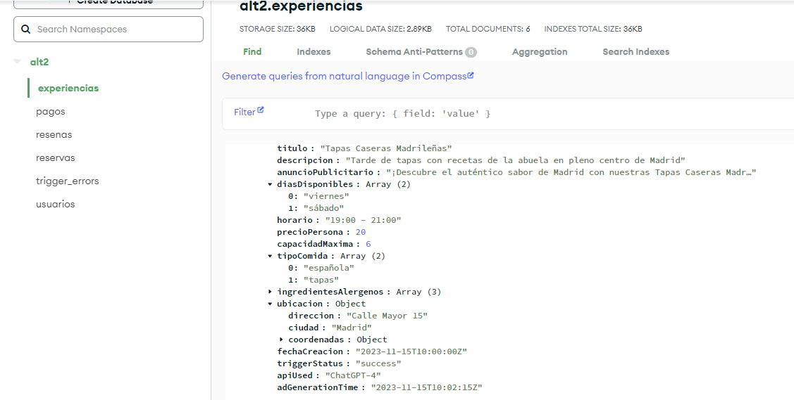

# Plataforma de experiencias culinarias con MongoDB

Trabajo final individual del módulo Fundamentos de Big Data. Diseñé una base documental para una plataforma que conecta anfitriones e invitados, y ejecuté un trigger que genera un anuncio cuando se registra una experiencia. El repositorio reúne el esquema de ejemplo, la función del trigger y una captura del resultado.

## Problema

¿Cómo organizar usuarios, experiencias culinarias, reservas, reseñas y pagos para una plataforma de reservas, y cómo automatizar la redacción de un anuncio al registrar una nueva experiencia? La propuesta permite explorar un prototipo de producto y consultar sus entidades principales.

## Datos y estructura

Los [archivos JSON](data/) contienen diez registros ficticios creados para el trabajo final: dos por colección. Incluyen los campos necesarios para relacionar anfitriones, invitados, experiencias y transacciones; no constituyen un historial de operaciones de una plataforma real. Las fechas de 2023 son parte de los ejemplos, no el periodo observado de un negocio. El [diccionario de datos](data/README.md) describe las relaciones y campos principales.

| Colección | Contenido principal |
| --- | --- |
| `usuarios` | Rol, datos de contacto y fecha de registro. |
| `experiencias` | Anfitrión, comida, disponibilidad, precio, capacidad y ubicación. |
| `reservas` | Experiencia, invitado, fecha, número de personas y estado. |
| `resenas` | Autor, destinatario, experiencia y calificación. |
| `pagos` | Reserva, monto, comisión, método y estado. |

La consigna del módulo planteó una plataforma similar a Airbnb para experiencias culinarias. Los diez registros sirven para mostrar la estructura y las relaciones; su tamaño no permite extraer conclusiones sobre demanda, ingresos o comportamiento de usuarios.

## Método y herramientas

Separé las entidades en cinco colecciones MongoDB y utilicé identificadores para vincular documentos relacionados. En MongoDB Atlas configuré un trigger de inserción sobre `alt2.experiencias`: recibe el nuevo documento, construye el texto de la experiencia, llama a una API de generación de texto y guarda el anuncio en la misma colección. El código de [trigger.js](trigger.js) muestra ese flujo y obtiene la clave de un valor secreto de Atlas; la clave no forma parte del repositorio.

**Habilidades aplicadas:** modelado de documentos y relaciones en MongoDB, estructuras JSON, funciones JavaScript de Atlas, eventos de inserción, llamadas HTTP a una API y revisión del resultado en MongoDB Compass.

## Resultado

La captura muestra un documento de `experiencias` con `anuncioPublicitario` y `triggerStatus: "success"`. La colección de esa captura contiene seis documentos; los archivos de este repositorio incluyen los dos ejemplos de experiencias descritos en la entrega. El [texto completo del anuncio](docs/ejemplo-anuncio.md) también está documentado. El campo `apiUsed` de la captura dice `GPT-4`, pero los materiales disponibles no incluyen el registro de la llamada para verificar qué modelo respondió. En [trigger.js](trigger.js), el modelo se indica mediante el valor `OPENAI_MODEL` de Atlas.

Como extensión conceptual, propuse un recomendador que combinaría preferencias de usuarios, características de las experiencias y contexto. La [propuesta detallada](docs/propuesta-recomendador.md) explica también cómo tratar usuarios nuevos y evitar recomendaciones repetitivas. No incluye un modelo entrenado ni resultados de evaluación.

## Aprendizajes

Aprendí a separar entidades relacionadas en colecciones MongoDB y a automatizar una acción al insertar una experiencia. Si repitiera el proyecto, probaría de forma más sistemática las rutas de error del trigger y documentaría cómo responde ante datos incompletos o fallos de la API.

## Cómo reproducir el prototipo

1. Crear una base `alt2` en MongoDB Atlas e importar los cinco archivos de `data/` en colecciones con el mismo nombre. Cada archivo es un arreglo JSON de dos documentos; [MongoDB Compass permite importar arreglos JSON](https://www.mongodb.com/docs/compass/import-export/).
2. Crear un [Database Trigger](https://www.mongodb.com/docs/atlas/atlas-ui/triggers/database-triggers/) para la operación `Insert` de la colección `experiencias`, asociado a la función de [trigger.js](trigger.js).
3. Configurar en Atlas los valores `OPENAI_API_KEY` como secreto y `OPENAI_MODEL` con un modelo disponible para la cuenta. La función consulta ambos mediante [`context.values.get`](https://www.mongodb.com/docs/atlas/atlas-ui/triggers/functions/values/).
4. Insertar una nueva experiencia con `anfitrionId`, `titulo` y `descripcion`, y comprobar los campos `anuncioPublicitario`, `triggerStatus` y `apiUsed`. La integración usa el endpoint de [Chat Completions](https://platform.openai.com/docs/api-reference/chat/create).

## Límites

El caso documenta un prototipo académico con registros de ejemplo. No evalúa carga, seguridad de una aplicación completa ni resultados comerciales. La propuesta de recomendación quedó en la etapa de diseño.
